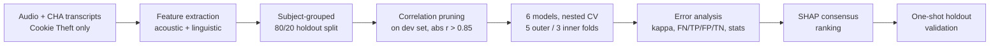

# Speech-Based Alzheimer's Detection and Error Analysis (DementiaBank Pitt, Cookie Theft)

A reproducible pipeline that classifies Alzheimer's disease (AD) vs. cognitively normal controls (CN) from **acoustic** and **linguistic** features of the Cookie Theft picture-description task, then goes beyond accuracy to ask a harder question: **which AD recordings do all models miss, and why?**

The whole analysis lives in one notebook, `pipeline_anonymized.ipynb`, written for Google Colab.

---

## Highlights

- **552 recordings** (309 AD, 243 CN) from **292 unique subjects**, Cookie Theft task only.
- **22 interpretable features** (9 acoustic, 13 linguistic), reduced to **20** by correlation pruning.
- **6 classifiers** tuned with **nested, subject-grouped cross-validation**.
- **Leakage-aware by design**: every split keeps all recordings of a subject together, and an untouched 20% holdout is used exactly once.
- **Error analysis**: model agreement (Fleiss' kappa), unanimous FN/TP/FP/TN groups, non-parametric group comparisons with FDR correction, SHAP consensus rankings, and a permutation test showing the shared errors are not chance.

## Results at a glance

| Model | CV accuracy (5-fold, 95% t-CI) |
|---|---|
| **SVM (best)** | **0.711** (0.664 to 0.758) |
| Logistic Regression | 0.700 (0.624 to 0.775) |
| XGBoost | 0.700 (0.636 to 0.764) |
| Random Forest | 0.685 (0.631 to 0.738) |
| MLP | 0.663 (0.625 to 0.701) |
| Gaussian NB | 0.618 (0.518 to 0.718) |

**Holdout (SVM, 120 recordings / 59 subjects):** accuracy 0.700 (subject-level bootstrap 95% CI 0.602 to 0.794), AUC 0.804, F1 0.710, sensitivity 0.710, specificity 0.690. The CV-to-holdout gap is 0.011.

**Error analysis (development set, 432 recordings):**

| Group | Meaning | Recordings | Unique subjects |
|---|---|---|---|
| FN | AD missed by all 6 models | 37 | 26 |
| TP | AD caught by all 6 models | 87 | 73 |
| FP | CN flagged by all 6 models | 4 | 3 |
| TN | CN correctly cleared by all 6 | 62 | 42 |

- Model agreement: **Fleiss' kappa = 0.52 (moderate)**; 190 of 432 recordings (44%) received a unanimous decision.
- The 37 unanimous misses are far above what independent errors would give (expected 0.2, permutation p = 0.0001). Because all models share the same features, correlated errors are expected, so this shows the overlap is real, not that the recordings are intrinsically unusual.
- FN recordings look **closer to controls than to detected AD** on 14 of 20 features.
- **MCI-labelled recordings are heavily over-represented among the misses**: 20 of 37 FN vs 2 of 87 TP (42 of 309 in the full AD group).

> Numbers above are from the executed run saved in the notebook. Re-running on a different Colab environment or library versions may shift them slightly.

---

## Pipeline



| Step | What happens |
|---|---|
| 1 | Load `.mp3` files from `Dementia/` and `Control/` folders (files under 10 KB are skipped); derive `subject_id` from the recording ID |
| 2 | Locate/extract `Pitt.zip`, keep `.cha` transcripts whose path contains `cookie`, parse participant (`*PAR`) lines and strip CHAT markup |
| 3 | Merge audio and transcripts on `participant_id` |
| 4 | Extract acoustic and linguistic features |
| 5 | Subject-grouped 80/20 split (`GroupShuffleSplit`), with an assertion that no subject appears on both sides |
| 6 | Drop one feature from every pair with abs(r) > 0.85, using the development set only |
| 7 | Nested CV: outer `StratifiedGroupKFold(5)`, inner `StratifiedGroupKFold(3)` with `GridSearchCV`; final hyperparameters are the per-fold mode, refit on the full dev set |
| 8 to 10 | Master prediction table, Fleiss' kappa, unanimous FN/TP/FP/TN groups |
| 11 | Mann-Whitney U (exact or asymptotic, with ties handled), permutation test, Cohen's d, Hedges' g with bootstrap CI, Benjamini-Hochberg FDR |
| 12 | SHAP per model (Linear, Tree, or Kernel explainer), per-model ranks, cross-model consensus rank |
| Figures | IEEE-style figures (PDF + PNG, single-hue palette) |
| 17 | Final holdout validation of the best model |
| 17A to 17F | Extra analyses: group sizes and unique subjects, detailed holdout metrics with subject-level bootstrap, FN vs TN comparison, chance-overlap permutation test, diagnostic-label breakdown (e.g. MCI) |

## Features

**Acoustic** (Praat via `parselmouth`, silence threshold -25 dB, minimum pause 0.1 s)
`duration_sec`, `pause_count`, `mean_pause_duration`, `max_pause_duration`, `total_pause_time`, `silence_ratio`, `speech_duration`, `mean_speech_segment`, `max_speech_segment`

**Linguistic** (spaCy `en_core_web_sm`, `lexicalrichness`)
`speech_rate_wpm`, `word_count`, `filled_pauses`, `type_token_ratio`, `mattr`, `mtld`, `pronoun_ratio`, `noun_ratio`, `verb_ratio`, `lexical_density`, `avg_sentence_length`, `avg_word_length`, `lexical_sophistication`

Pruned automatically in the reported run: `duration_sec` (r = 0.91 with `total_pause_time`) and `lexical_sophistication` (r = 0.87 with `avg_word_length`).

---

## Getting started

### 1. Get the data

This project uses the **Pitt corpus from [DementiaBank](https://dementia.talkbank.org/)**. Access requires registering with TalkBank and agreeing to its terms. **The data is not included in this repository and must not be redistributed.**

Arrange it in Google Drive like this:

```
MyDrive/
└── DementiaBank_Audio/
    ├── Dementia/            # *.mp3  (AD recordings)
    ├── Control/             # *.mp3  (control recordings)
    └── Transcripts/
        └── Pitt.zip         # CHAT (.cha) transcripts
```

The notebook also tries a few alternative locations for `Pitt.zip` or already-extracted transcripts. If you use a different layout, edit `base_dir`, `zip_path` and the `alt_*` path lists in Step 2.

### 2. Run

1. Open `pipeline_anonymized.ipynb` in **Google Colab**.
2. Run all cells in order. The first cell mounts Google Drive; authorize access when prompted.
3. Step 4 installs dependencies (`!pip install ...` and the spaCy model). If Colab asks you to restart the runtime after the install, restart and continue from Step 4.

Acoustic feature extraction takes roughly 6 to 7 minutes for 552 files on Colab. The grid search over 432 XGBoost combinations is the slowest modelling step.

Running outside Colab? Remove the `google.colab` import and `drive.mount`, and change the `/content/...` paths.

### Dependencies

`numpy`, `pandas`, `scipy`, `scikit-learn`, `xgboost`, `statsmodels`, `shap`, `matplotlib`, `seaborn`, `tqdm`, `praat-parselmouth`, `spacy` (+ `en_core_web_sm`), `lexicalrichness`, `librosa`, `soundfile`, `nltk`, `upsetplot`

All randomness is seeded with `RANDOM_STATE = 42`.

## Outputs

Written to `/content/` in Colab (copy them to Drive to keep them):

| File | Contents |
|---|---|
| `pitt_master_predictions_final.csv` | Out-of-fold prediction of every model for every dev recording |
| `pitt_FN_vs_TP_robust_final.csv`, `pitt_FP_vs_TN_robust_final.csv` | Group comparisons with effect sizes, CIs and FDR q-values |
| `pitt_shap_<GROUP>_<MODEL>.csv` | Per-model SHAP importance and ranks |
| `pitt_shap_consensus_<GROUP>.csv` | Cross-model consensus ranking (GROUP = TP, FN, FP, TN) |
| `viz_shap_summary_<GROUP>_<MODEL>.png` | SHAP summary plots |
| `viz_figure1_accuracy`, `viz_figure2a/b_shap_*`, `viz_figure3a/b/c_*`, `viz_figure4_pipeline` (`.pdf` / `.png`) | Publication-style figures |

## Methodological notes

- **No subject leakage.** About half the recordings come from subjects with multiple sessions, so every split (holdout, outer CV, inner CV) is grouped by `subject_id`.
- **No selection leakage.** Feature pruning uses the development set only; the holdout never influences any choice.
- **Honest uncertainty.** CIs use Student's t across folds, and the holdout CI resamples subjects, not recordings.
- **Multiple comparisons.** All feature-level tests use Benjamini-Hochberg FDR.

## Limitations

- **Small unanimous-FP group (n = 4).** FP vs TN results are exploratory only.
- **Correlated models.** All six models see the same 20 features, so agreement overstates independent evidence.
- **Diagnostic heterogeneity.** The "AD" class includes MCI, possible AD, vascular and other labels. The over-representation of MCI among missed cases suggests part of the "miss" is a label-definition effect.
- **Speech rate definition.** `speech_rate_wpm` divides participant-only transcript words by the duration of the full recording, so it also reflects non-participant audio.
- **Single dataset and task.** Results are for one English corpus and one picture-description task, with a modest holdout (120 recordings); they should not be read as clinical performance.
- **Not a diagnostic tool.** This is research code.

## Repository layout

```
.
├── pipeline_anonymized.ipynb   # full pipeline (Steps 1 to 17F)
└── README.md
```

## Citation

If you use this code, please cite the accompanying paper and the DementiaBank Pitt corpus:

> Becker, J. T., Boller, F., Lopez, O. L., Saxton, J., & McGonigle, K. L. (1994). The natural history of Alzheimer's disease: description of study cohort and accuracy of diagnosis. *Archives of Neurology, 51*(6), 585-594.

## Acknowledgements

DementiaBank / TalkBank for the Pitt corpus; the maintainers of Praat/Parselmouth, spaCy, scikit-learn, XGBoost and SHAP.
